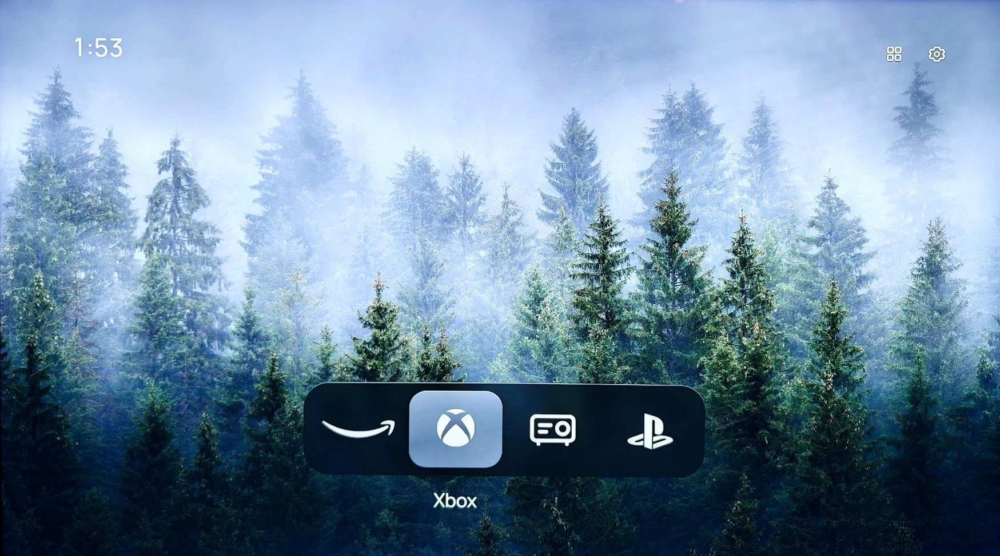

# CleanFrame for a Samsung Q95T

This fork adapts [nthnclrk/CleanFrame](https://github.com/nthnclrk/CleanFrame) (MIT), v0.7.0, for a 2020 Samsung QLED Q95T. That TV runs Tizen 5.5 but is not a Frame. The fork makes three groups of changes:

1. **HDMI devices on Home.** Each HDMI port can be named as a device, such as an Xbox, PlayStation or amp. It then sits on Home as a tile next to your apps, and OK switches straight to that input.
2. **No Art Mode.** The Art Mode control is removed, because this TV ignores the Frame-only command behind it.
3. **Startup watcher.** A small Linux service opens CleanFrame every time the TV turns on, without changing any TV settings.



*On the TV: Dock layout with icons only, a misty forest wallpaper, and three HDMI devices beside Prime Video. The top right shows only All apps and Settings.*

Everything else, including the List and Dock layouts, wallpapers, fonts, Focus materials, the app editor, All apps and Settings → Samsung → Inputs, is upstream CleanFrame. The app's source identity in `app/config.xml` is upstream's sample; build with your own, as upstream's setup guide describes.

---

## 1. HDMI devices on Home

Upstream 0.7.0 can switch inputs, but only from a list under Settings → Samsung → Inputs. This fork adds a new **Settings → HDMI devices** group, which turns each connected device into a Home tile.

**Setting a device**

- The group lists HDMI 1–4 and, for each, what is assigned and whether it's on Home.
- OK on a port opens its device list: **Not shown**, **Xbox**, **PlayStation**, **Nintendo**, **Amp**, **PC**, **Media box** or **Other device**. OK on a device applies it at once and shows a checkmark.
- **Other device** is named after its port, for example "HDMI 3".

**On Home**

- An assigned device is added to the end of Home when there's room. When Home is full (nine items), it waits in **Apps on Home**, listed first under *Not on Home*.
- It then behaves like an app: you can reorder, remove and restore it, and it's remembered as the last selection.
- Changing a port's device keeps its place on Home. **Not shown** removes it from Home and from saved preferences. The last remaining Home item can't be hidden.
- OK switches to that exact port with `tizen.tvwindow.setSource`, then opens the TV viewer. That's the same path as Settings → Samsung → Inputs.

**Storage**

- Port assignments are saved as `inputs` in the existing `cleanframe.home.v1` preferences, for example `{"1": "xbox", "3": "mediabox"}`.
- HDMI tiles are never saved as app records, and bad or unknown values are dropped when preferences load.
- Saving a device and its Home position is one write. If it fails, both stay as they were and **Try again** retries the same choice.

**Icons**

- Xbox, PlayStation and Nintendo (the Switch mark) come unchanged from [Simple Icons](https://simpleicons.org/) 11.15.0 (CC0), filled white like the app marks.
- Amp, PC, Media box and Other device are new outlines drawn in CleanFrame's own utility style: a 24 px grid and 1.6 px stroke.
- All seven are listed in `app/assets/icons/SOURCES.json` and measured in `metrics.js`, so they size like the other marks.

**Rendering fixes it needed**

- Home tiles, List rows and both halves of the Apps on Home editor now redraw when an item's name or icon changes under the same ID. Without this, changing a port's device (Xbox to PlayStation, say) could leave the old name or icon on screen.
- The Settings overview rows are a little tighter (100 px instead of 112 px, with smaller gaps), so the seventh group fits above the remote hint.

## 2. No Art Mode

Upstream's Home controls are Art Mode, All apps and Settings. Art Mode sends `org.tizen.art-app` an app-control with `mode=fullscreen` and `requester=mobile`, which is an undocumented Frame contract. On the Q95T the Art app is installed, but that command visibly did nothing.

The fork removes the control and its device call (`FrameDevice.art`) rather than pointing it at an undocumented Ambient Mode target. Home now has two controls: **All apps** and **Settings**. Navigation is otherwise unchanged; in Dock, Up from the apps lands on All apps.

## 3. Startup watcher

Samsung TVs can autorun the last app, but they have no setting for a fixed startup app. Upstream's route to a fixed startup app is the optional native Home/startup helper, which writes undocumented TV settings and depends on the firmware. The watcher instead runs on a separate always-on Linux machine on the same network, such as a home server or a Raspberry Pi. It only uses the TV's local remote-control API, so it changes no TV settings, and removing the service undoes it completely.

```
           every 3 s: GET http://TV:8001/api/v2/  ->  PowerState
                               |
      first check -------------+---- off/standby -> on
      leave the screen alone   |
                               v
               wait 4 s for the TV to settle
                               |
          +--------------------+---------------------+
          | up to 4 attempts:                        |
          |   TV no longer on?         -> stop        |
          |   CleanFrame on screen?    -> stop        |
          |   POST /api/v2/applications/APP_ID       |
          |     (last attempt: paired WebSocket)     |
          |   check visibility every 0.5 s for 4 s   |
          |     seen on screen once    -> stop        |
          +------------------------------------------+
```

1. **Power detection.** The TV's REST API on port 8001 answers while the TV is on or in network standby, and `device.PowerState` says which. No answer counts as off. The watcher acts only on a change to on, so a TV that's already on when the watcher starts is left alone.
2. **Settle.** Right after power-on the TV briefly shows Samsung Home or the last app and may ignore requests, so the watcher waits a few seconds.
3. **Launch.** `POST /api/v2/applications/APP_ID` asks the TV to open the app. On the Q95T this brings the already-running web app to the front.
4. **Confirm.** The `visible` field of `GET /api/v2/applications/APP_ID` is checked about every half second. Once CleanFrame has been on screen, the watcher is done. A source or app picked afterwards is the viewer's choice and is never undone.
5. **Retry and fallback.** If CleanFrame never appears, it tries up to four times in all. The last try uses Samsung's remote-control WebSocket (`wss://TV:8002`, `ed.apps.launch` with `NATIVE_LAUNCH`). That channel needs a one-time **Allow** on the TV, and the token is saved with owner-only permissions. If pairing is denied, the watcher stops retrying.
6. **TVs that don't report visibility.** One accepted request counts as success, so the watcher can't keep relaunching over the viewer.

It's packaged as a hardened systemd service with an installer (`--dry-run`, `--no-pair`, `--pair-only`) and an uninstaller. Setup, tuning and removal are in [`scripts/startup-watcher/README.md`](scripts/startup-watcher/README.md).

**Watcher limits**

- Samsung Home or the last app shows for about 2 seconds before CleanFrame opens.
- The TV doesn't report which source is selected, so a source picked before CleanFrame appears is replaced once by CleanFrame.
- HDMI-CEC wake-ups, such as a console turning the TV on, also open CleanFrame.
- It only works while its machine is on and can reach the TV. Give the TV a fixed address with a DHCP reservation.

---

## Files changed from upstream 0.7.0

| Area | Files |
|---|---|
| HDMI devices, Art Mode removal | `app/main.js`, `app/device.js`, `app/style.css` |
| Device icons | `app/assets/icons/{xbox,playstation,nintendo,amp,pc,mediabox,hdmi}.svg`, `SOURCES.json`, `metrics.js` |
| Behaviour docs | `docs/interaction-behaviour.md` (Home controls, the HDMI devices group, Samsung screens) |
| Checks | `scripts/check-browser.mjs` (HDMI device coverage, two Home controls), `scripts/check.py` (new icons) |
| Startup watcher | `scripts/startup-watcher/`: watcher, installer, uninstaller, systemd unit, README, offline tests |
| Fork docs | `FORK.md`, a fork note in `README.md`, `docs/images/cleanframe-q95t-dock.jpg` |

## Tested

- **Hardware:** a 2020 Samsung QLED Q95T on Tizen 5.5, running a build signed with its owner's identity. The screenshot above is from that TV. Startup, the shorter watcher timings, and leaving a source picked after CleanFrame appears were confirmed there.
- **Browser checks:** when the app changes were made, upstream's suite passed with the HDMI checks added (466 checks).
- **Python checks:** for this published copy, `scripts/check.py` and the 12 offline watcher tests pass.
- **Not tested:** The Frame and other models. Upstream's Art Mode still applies to Frame owners, who may prefer upstream's Home controls.

## Licence

As upstream, original code is MIT ([LICENSE](LICENSE)). The Xbox, PlayStation and Nintendo Switch marks come from Simple Icons (CC0; licence in `app/assets/icons/SIMPLE-ICONS-LICENSE.txt`). They remain trademarks of their owners and are used only to label the connected devices.
